<div align="center">

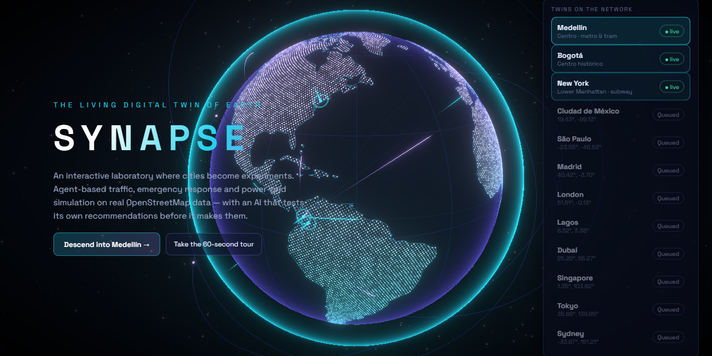

# SYNAPSE

### The Living Digital Twin of Earth

**An interactive laboratory that turns urban problems into reproducible experiments —
with an AI agent that tests its own recommendations before it makes them.**

[](https://github.com/saracastrillons/synapse/actions/workflows/ci.yml)
[](LICENSE)


[Features](#-features) · [How it works](#-how-it-works) · [Architecture](#-architecture) · [Run it](#-run-it) · [Testing](#-testing) · [Data honesty](#-data--honesty)

</div>

---

SYNAPSE simulates three real downtowns on their OpenStreetMap data — **Medellín Centro**, **Bogotá Centro** and **Lower Manhattan** — with their actual streets, rail lines, stations, hospitals, fire stations and substations, **~1,300 autonomous vehicles** whose demand follows the time of day, timetabled metro and tram trains, emergency units and a power grid. You can break the city (block an avenue, trip a substation, unleash a storm), test interventions in controlled experiments, rewind time to change a decision, and ask an AI agent what to do. Every answer it gives is backed by simulations you can re-run with the same seed.

> **Try asking:** *"A major accident just blocked Avenida Oriental. Find the fastest way to restore traffic flow."*
> The agent blocks the road, computes the detour with A\* and Dijkstra, simulates four response strategies on identical seeds, ranks them and asks you to confirm the winner.

<p align="center">
  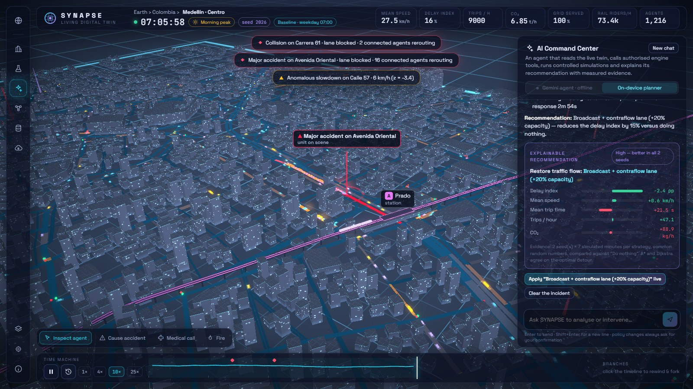
</p>

## ✨ Features

<table>
<tr>
<td width="50%" valign="top">

**🌍 Earth Command**<br/>
Holographic globe with 20k land points, data arcs and satellites. Click Medellín and the camera descends from orbit into the city.

</td>
<td width="50%" valign="top">

**🏙️ City Twin**<br/>
Roads coloured by live congestion, 7,463 buildings whose windows go dark during blackouts, traffic signals, emergency routes, heatmap, rain and lightning.

</td>
</tr>
<tr>
<td>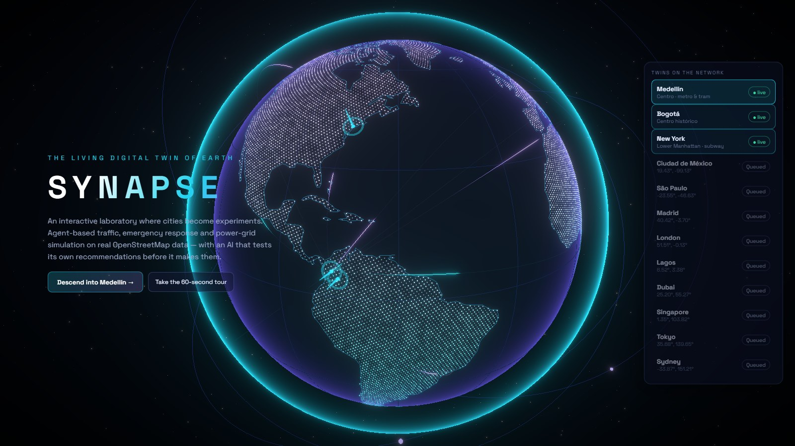</td>
<td>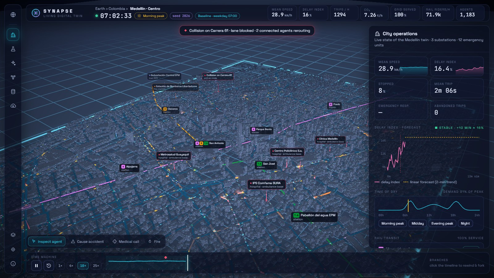</td>
</tr>
<tr>
<td width="50%" valign="top">

**🧪 Scenario Lab**<br/>
Six situations (accident, +40 % demand, storm & blackout, ambulance gauntlet, heat wave…). A/B experiments on common random numbers, mean ± sd across seeds, CSV/JSON export, share links and a printable executive report.

</td>
<td width="50%" valign="top">

**⏪ Time Machine**<br/>
Rewind to any moment, change a decision and watch the new timeline diverge from the dashed original — deterministic replay guaranteed by tests.

</td>
</tr>
<tr>
<td>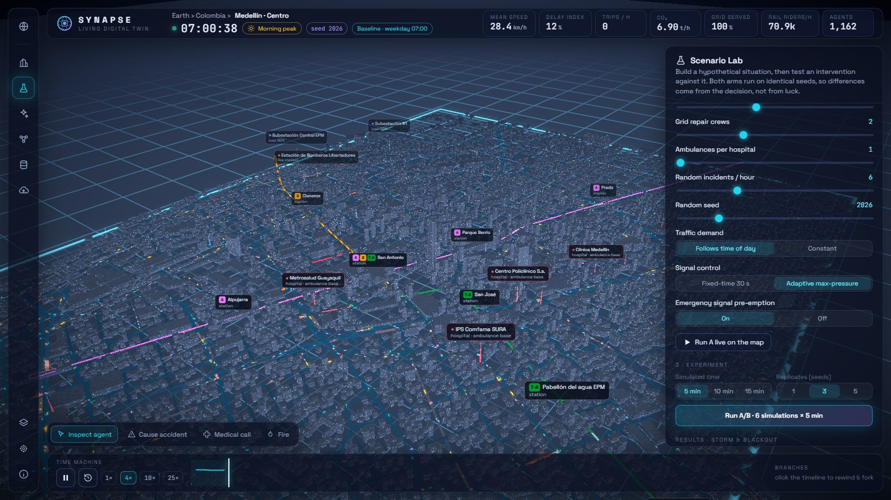</td>
<td>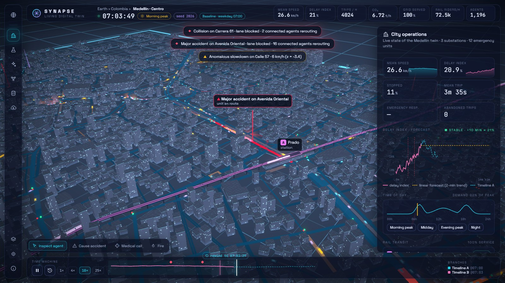</td>
</tr>
<tr>
<td width="50%" valign="top">

**⚖️ Compare experiments**<br/>
Two versions of the city side by side: KPI deltas, time series, pairing warnings and server-side Welch t-tests.

</td>
<td width="50%" valign="top">

**📱 Works on phones**<br/>
Responsive HUD: full-screen map, panels one tap away. Verified by end-to-end tests on a Pixel 7 viewport.

</td>
</tr>
<tr>
<td>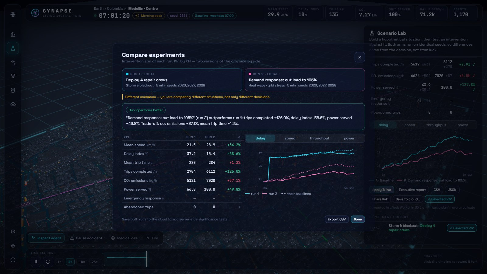</td>
<td align="center">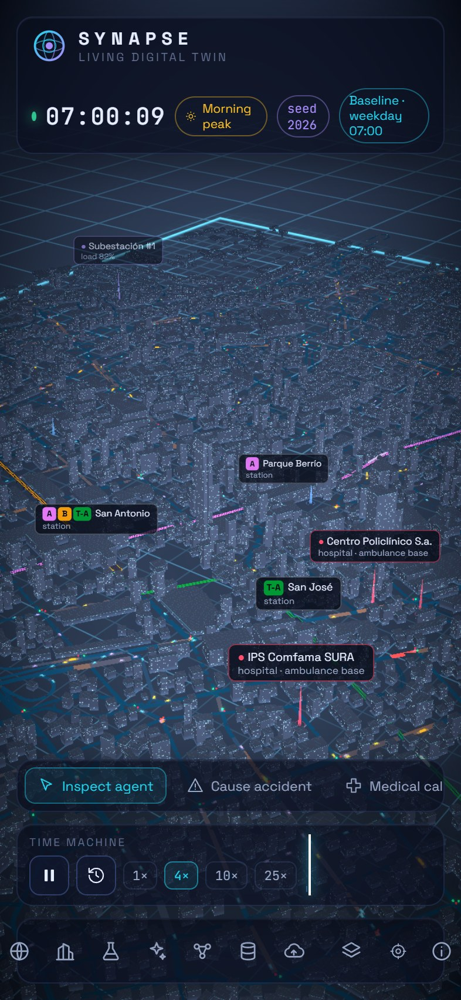</td>
</tr>
</table>

<table>
<tr>
<td width="50%" valign="top">

**🚇 Metro, trams and the time of day**<br/>
Real rail lines and stations from OSM — Medellín's elevated Metro A/B and the Ayacucho tramway, 17 New York subway services with their official colours. Trains run on a timetable whose frequency follows the day; traffic peaks at 07:30 and 18:00 and empties at night, and a rail outage pushes riders onto the roads.

</td>
<td width="50%" valign="top">

**🌎 Three cities**<br/>
Pick a city on the globe: **Medellín** (metro & tram), **Bogotá** (historic centre, Metro Line 1 shown as *under construction* — it is not in service yet) or **New York** (skyscrapers with mapped heights up to 417 m, underground subway). Every scenario adapts to the city's own avenues.

</td>
</tr>
<tr>
<td>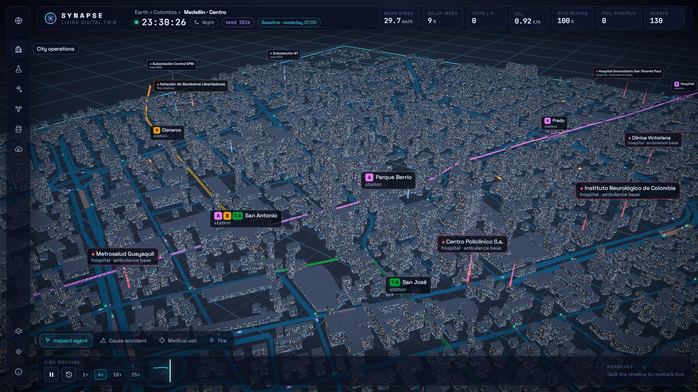</td>
<td>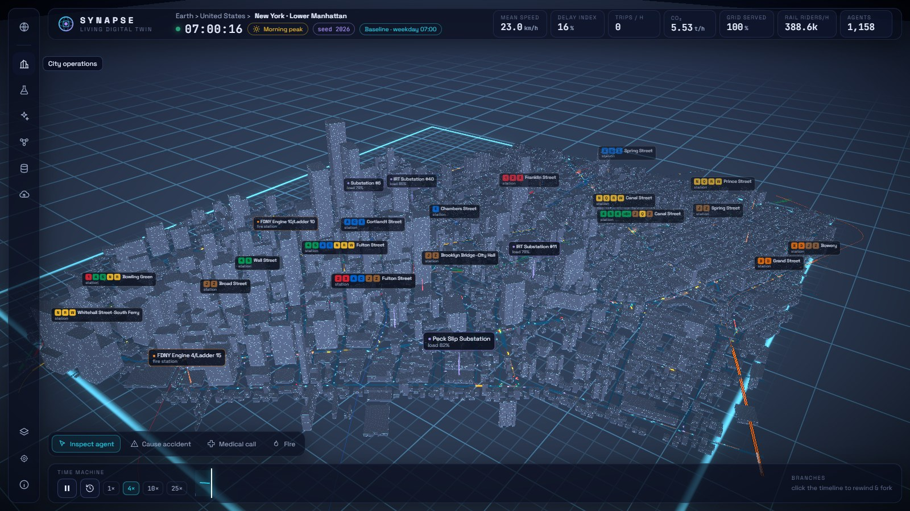</td>
</tr>
</table>

**Also inside:** a 60-second guided tour for first-time visitors · autonomous agents with readable decision logs · ETA-optimal ambulance dispatch with signal pre-emption · power grid with storm/overload failures and repair crews · anomaly detection and congestion forecast · accounts, shared projects, versioned scenarios, comments and live collaboration.

## 🧠 How it works

### The simulation engine

A deterministic agent-based engine written in TypeScript, shared by the live 3D view and a Web Worker that runs headless experiments.

| Component | Model |
|---|---|
| Vehicles | Intelligent Driver Model car-following on a lane-level directed graph; personal headway and speed preferences |
| Navigation | A\* (admissible heuristic) and Dijkstra on live travel times; connected drivers re-plan, others only react to what they see |
| Junctions | Fixed-time vs **max-pressure** adaptive signals; blackout turns them into all-way stops; emergency pre-emption |
| Emergencies | Poisson incidents, severity-ordered dispatch minimising A\* ETA over all idle units |
| Power grid | Substations sized at 122 % of base load, failure hazard from storm² and overload, repair time scales with crews |
| Analytics | Per-edge z-score anomaly detection, least-squares forecast of the delay index |
| Time of day | Two-peak daily demand curve (07:30, 18:00, lunchtime shoulder, night trough); day/night lighting |
| Rail transit | Daily timetables with time-of-day headways, trapezoidal speed profile and dwell times; services sharing a trunk split its frequency; a suspension freezes trains and shifts ~18 % of riders to the roads |

Fixed 0.2 s step and a single seeded PRNG stored inside the state: **same seed + parameters + events ⇒ identical run**, in Node and in the browser. Time Machine snapshots are bounded (≈70 MB worst case) and thinned as they age.

### The AI agent

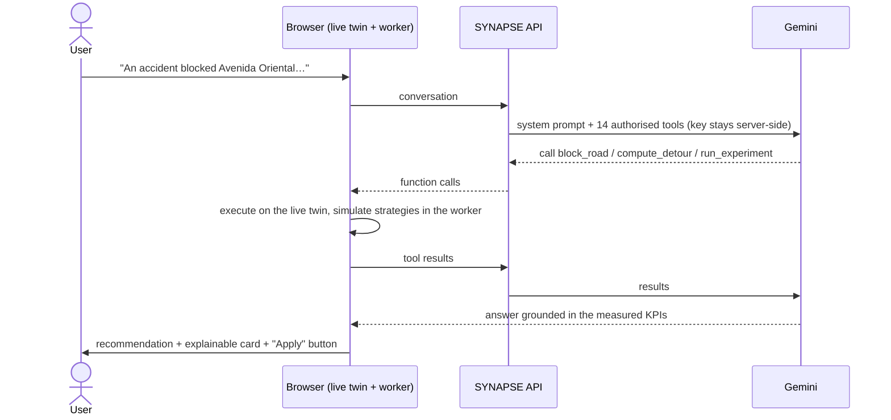

The instant on-device planner is the default; the Gemini agent is one click away and shows a live timer for every step. Guard-rails: the model only *proposes* policy changes (the user confirms), parameters it supplies are sanitised and clamped, the loop is step-bounded and rate-limited, overloaded models fall back to another model, and if the LLM is unavailable a deterministic on-device planner answers instead.

## 🏗️ Architecture

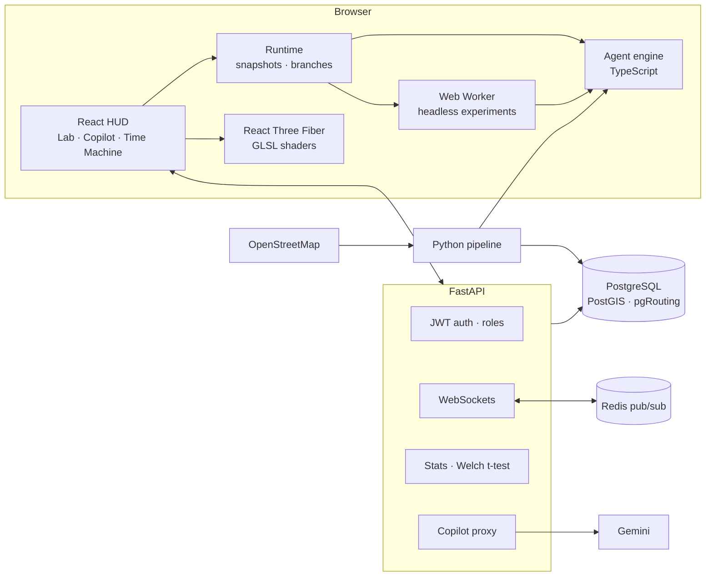

| Layer | Stack |
|---|---|
| Frontend | React 19, TypeScript, React Three Fiber, custom GLSL, Zustand, Vite, Web Workers |
| Backend | FastAPI, SQLAlchemy 2, PostgreSQL + PostGIS + pgRouting (SQLite in dev), Redis, JWT, WebSockets |
| AI | Gemini function calling behind a server-side proxy with model fallback |
| Data | OpenStreetMap via Overpass, Natural Earth, Python pipeline (graph simplification, Kosaraju SCC) |
| Quality | Vitest, pytest, Playwright, GitHub Actions, Docker Compose |

```
synapse/
├── frontend/         React app, simulation engine (src/sim), 3D (src/three), AI agent (src/ai), E2E tests (e2e/)
├── backend/          FastAPI: auth, projects, scenarios, experiments, sharing, geo, copilot proxy
├── pipeline/         OSM → road graph, buildings, facilities · Natural Earth → globe
├── docs/screenshots/ README images (regenerate with Playwright)
└── docker-compose.yml
```

## 🚀 Run it

**Just the twin** (runs entirely in the browser — no server needed):

```bash
cd frontend
npm install
npm run dev            # http://localhost:5173
```

**Full stack** with Docker — PostgreSQL + PostGIS + pgRouting, Redis, API and web:

```bash
echo GEMINI_API_KEY=your-key > .env    # optional: enables the Gemini agent
docker compose up --build              # web http://localhost:8080 · API docs http://localhost:8010/docs
```

<details>
<summary>Backend without Docker</summary>

```bash
cd backend
python -m venv .venv
.venv/Scripts/python -m pip install -r requirements.txt     # Windows; use .venv/bin on macOS/Linux
.venv/Scripts/python -m uvicorn app.main:app --port 8010
```

Configuration lives in `backend/.env` — see [`backend/.env.example`](backend/.env.example) and [backend/README.md](backend/README.md).
</details>

<details>
<summary>Rebuild the datasets</summary>

```bash
python pipeline/fetch_osm.py all  # roads, buildings, facilities and rail for medellin, bogota, newyork
python pipeline/build_globe.py    # land points and coastlines from Natural Earth
```
</details>

## ✅ Testing

| Suite | What it proves | Command |
|---|---|---|
| **Engine** (16, Vitest) | A\* = Dijkstra optimum with fewer expansions, determinism, Time-Machine exact replay, dispatch, grid failures, demand curve, rail timetables and outages | `npm test` |
| **API** (27, pytest) | auth & roles, validation, server-side statistics, sharing, WebSockets, PostGIS queries, copilot proxy & fallbacks | `pytest` |
| **End-to-end** (14, Playwright) | real Chromium: descent, guided tour, copilot, mocked Gemini tool loop, Lab + CSV + compare, Time Machine, share links, city switching, rail outage, night mode, phone layout | `npm run e2e` |

CI runs everything on every push, including the API suite against **real PostgreSQL + PostGIS + pgRouting**.

## 🔍 Data & honesty

Roads, rail lines, stations, critical facilities and building footprints come from **© OpenStreetMap contributors (ODbL)**. Where a downtown is only partly mapped (Medellín, Bogotá) extra buildings are procedurally generated to fill the blocks and are flagged in the dataset. Line colours come from OSM when tagged (New York, the Medellín tramway); otherwise distinct non-official colours are used. Bogotá's Metro Line 1 is mapped as under construction, so it carries no trains. Traffic demand, electrical loads and incidents are **synthetic, seeded and uncalibrated**: SYNAPSE compares strategies — it does not forecast Medellín's real traffic.

## 🗺️ Roadmap

- [ ] Public deployment (static front end + managed PostGIS)
- [x] Rail transit, time-of-day demand and multiple cities
- [ ] Pedestrians and bus networks (BRT such as TransMilenio and Metroplús)
- [ ] Calibration against open traffic counts · more cities
- [ ] Alembic migrations, observability (Prometheus/OpenTelemetry)

---

<div align="center">

Built by **[saracastrillons](https://github.com/saracastrillons)** · Systems Engineering

Part of a portfolio with [**NEXUS**](https://github.com/saracastrillons/nexus) (observes the world) and **AETHER** (analyses business data) —
SYNAPSE lets you experiment with what *could* happen before you decide.

</div>
